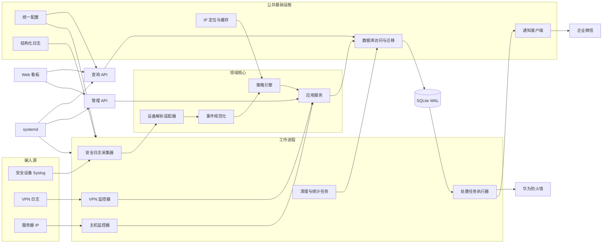
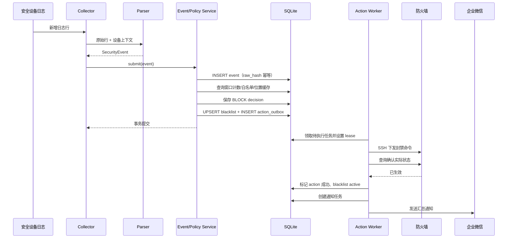
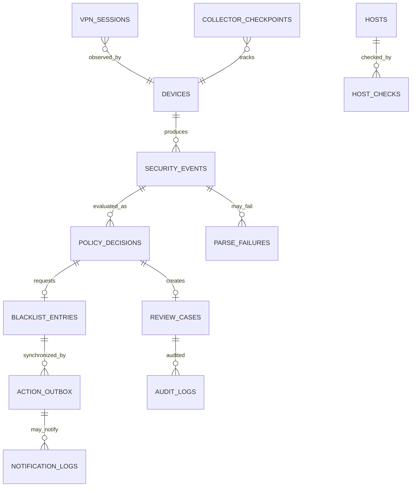

# 安全监控系统 3.0 架构设计

> 文档状态：Draft v1.0  
> 适用版本：Monitor 3.0  
> 目标环境：Linux / Python 3.11+  
> 更新时间：2026-07-13

## 1. 设计目标

Monitor 3.0 对 2.0 进行结构化重建，不直接复制旧项目文件。核心目标如下：

1. 建立统一公共模块，消除各监控脚本重复实现日志、通知、配置、IP 定位、白名单和状态存储的问题。
2. 所有环境相关配置、凭据和规则参数从源码抽离；源码中不得出现密码、Webhook、真实设备地址等敏感信息。
3. 使用统一安全事件模型，将“日志解析”“策略判断”“处置动作”解耦。
4. 优化 SQLite 并发访问：所有业务代码通过仓储层访问数据库，启用 WAL、短事务、忙等待、原子 UPSERT 和迁移管理。
5. 将人工审核、VPN 状态、主机状态、服务状态和通知记录从零散 JSON 迁移到数据库。
6. 查询 API 与高权限管理 API 分离；所有管理操作必须认证、授权和审计。
7. 所有模块可单独测试，新增一种日志设备时只需要增加解析适配器和配置。

## 2. 范围与非目标

### 2.1 本期范围

- 华为 IPS/WAF、DPTech IPS、DPTech WAF、天融信 WAF 日志监控。
- 华为 SSL VPN 登录/退出监控。
- 服务器 IP 在线状态监控。
- 黑名单策略判断和华为防火墙同步。
- 企业微信通知。
- 实时看板、查询 API、管理 API。
- 进程健康状态、审计和基础统计。

### 2.2 暂不引入

- Kafka、RabbitMQ 等外部消息中间件。
- PostgreSQL、MySQL 等独立数据库服务。
- 微服务或 Kubernetes。
- 复杂的用户中心和多租户体系。

当前数据量优先采用“模块化单体代码库 + 多进程采集 + SQLite WAL”。事件量或节点数超过单机能力后，可保持接口不变，将事件总线和仓储替换为外部服务。

## 3. 总体架构



### 3.1 核心处理原则

- 采集器只负责增量读取日志、调用解析器、提交规范化事件。
- 解析器只负责把厂商日志转换为统一事件，不访问数据库、不发通知、不执行封禁。
- 策略引擎只根据事件、规则、白名单和地域信息输出决策。
- 应用服务在事务中保存事件和决策，并创建待执行任务。
- Action Worker 从任务表领取任务，执行防火墙或通知动作，记录结果并可靠重试。
- API 不扫描原始日志生成统计；所有展示数据来自结构化数据库。

## 4. 推荐项目结构

```text
monitor3.0/
├── pyproject.toml
├── README.md
├── .env.example
├── config/
│   ├── base.yaml
│   ├── production.yaml.example
│   ├── devices.yaml.example
│   └── rules.yaml
├── migrations/
│   └── versions/
├── src/monitor/
│   ├── __init__.py
│   ├── common/
│   │   ├── config.py
│   │   ├── logging.py
│   │   ├── errors.py
│   │   ├── time.py
│   │   ├── validation.py
│   │   └── ids.py
│   ├── domain/
│   │   ├── models.py
│   │   ├── enums.py
│   │   ├── policies.py
│   │   └── decisions.py
│   ├── collectors/
│   │   ├── base.py
│   │   ├── file_tail.py
│   │   └── security_log.py
│   ├── parsers/
│   │   ├── base.py
│   │   ├── huawei_ips.py
│   │   ├── dptech_ips.py
│   │   ├── dptech_waf.py
│   │   └── topsec_waf.py
│   ├── services/
│   │   ├── event_service.py
│   │   ├── policy_service.py
│   │   ├── blacklist_service.py
│   │   ├── review_service.py
│   │   ├── vpn_service.py
│   │   ├── host_service.py
│   │   └── action_service.py
│   ├── repositories/
│   │   ├── unit_of_work.py
│   │   ├── event_repository.py
│   │   ├── blacklist_repository.py
│   │   ├── review_repository.py
│   │   ├── action_repository.py
│   │   └── state_repository.py
│   ├── infrastructure/
│   │   ├── database.py
│   │   ├── notifier.py
│   │   ├── geolocation.py
│   │   ├── firewall.py
│   │   ├── process_status.py
│   │   └── metrics.py
│   ├── workers/
│   │   ├── collector_worker.py
│   │   ├── vpn_worker.py
│   │   ├── host_worker.py
│   │   ├── action_worker.py
│   │   └── maintenance_worker.py
│   └── api/
│       ├── app.py
│       ├── dependencies.py
│       ├── auth.py
│       ├── schemas.py
│       └── routes/
│           ├── query.py
│           ├── reviews.py
│           ├── administration.py
│           └── health.py
├── web/
│   ├── dashboard.html
│   └── static/
├── deploy/
│   ├── systemd/
│   └── logrotate/
├── tests/
│   ├── unit/
│   ├── integration/
│   ├── fixtures/logs/
│   └── contract/
└── docs/
    └── architecture.md
```

## 5. 模块设计

### 5.1 `common` 公共模块

| 模块 | 职责 | 约束 |
|---|---|---|
| `config.py` | 合并 YAML、环境变量和默认值；类型校验；启动时验证 | 其他模块不得直接读取环境变量或 YAML |
| `logging.py` | JSON/文本结构化日志、上下文字段、脱敏、轮转配置 | 禁止各模块自行实现文件日志函数 |
| `errors.py` | 定义配置、解析、仓储、外部服务等异常层级 | 禁止静默吞掉业务异常 |
| `time.py` | 统一时区、UTC 存储、展示转换 | 数据库时间统一为 UTC ISO 8601 |
| `validation.py` | IP、CIDR、端口和设备字段校验 | 外部输入必须先验证 |
| `ids.py` | 生成事件 ID、任务 ID、关联 ID | 推荐 UUIDv7 或 ULID |

日志至少包含：`timestamp`、`level`、`service`、`event_id`、`action_id`、`device`、`message`、`error_type`。密码、Token、Webhook、Cookie 不得进入日志。

### 5.2 `domain` 领域模块

统一事件对象 `SecurityEvent`：

| 字段 | 类型 | 说明 |
|---|---|---|
| `id` | string | 全局事件 ID |
| `occurred_at` | datetime | 设备事件时间，UTC |
| `received_at` | datetime | 系统接收时间，UTC |
| `source` | enum | HUAWEI_IPS、DPTECH_WAF 等 |
| `device_id` | string | 设备配置 ID |
| `event_type` | string | attack、vpn_login、host_status 等 |
| `src_ip` | IPv4/IPv6 | 来源地址 |
| `dst_ip` | IPv4/IPv6/null | 目标地址 |
| `category` | string | 规范化攻击类别 |
| `vendor_category` | string | 原始厂商类别 |
| `severity` | enum | low、medium、high、critical |
| `raw_hash` | string | 原始日志哈希，用于去重 |
| `attributes` | JSON | 厂商特有字段 |

策略输出 `PolicyDecision`：

- `IGNORE`：白名单或明确无需处理。
- `OBSERVE`：只入库统计。
- `NOTIFY`：发送普通告警。
- `MANUAL_REVIEW`：创建人工审核单。
- `BLOCK`：创建防火墙封禁任务。

决策必须保存规则版本、命中原因、窗口计数和地域判断结果，保证事后可解释。

### 5.3 `collectors` 与 `parsers`

采集器采用统一检查点模型：

- 检查点包含文件设备号、inode、路径、偏移量和最后事件时间。
- 文件轮转后根据 inode 识别旧文件，读完剩余内容再切换。
- 每批事件成功提交后才更新检查点，保证“至少一次”读取。
- 通过 `raw_hash` 唯一索引实现幂等，消除重复事件。
- 单条解析失败写入 `parse_failures`，不得使采集进程退出。

每个解析适配器实现：

```python
class LogParser(Protocol):
    source: EventSource

    def matches(self, line: str) -> bool: ...
    def parse(self, line: str, context: ParseContext) -> SecurityEvent: ...
```

### 5.4 `services` 应用服务

- `event_service`：校验、去重、保存事件，触发策略评估。
- `policy_service`：滑动窗口计数、白名单、地域和规则匹配。
- `blacklist_service`：申请、续期、取消封禁；不直接连接防火墙。
- `review_service`：创建、认领、批准、拒绝、关闭人工审核单。
- `action_service`：在数据库事务中创建 Outbox 任务。
- `vpn_service`：维护 VPN 会话和登录异常事件。
- `host_service`：维护主机探测状态、连续失败次数和通知节流。

地理定位属于可降级的外部增强能力。成功结果按配置长期缓存；失败结果短期缓存。连续失败达到
阈值后打开进程内熔断器，在冷却时间内直接返回 `UNKNOWN`，避免供应商故障时针对每个新 IP
持续发起超时请求。`UNKNOWN` 会进入安全的人工审核路径，不会丢弃原始事件。

### 5.5 `infrastructure` 基础设施适配器

- `firewall.py`：SSH 连接、主机密钥校验、命令模板、结果解析和回查验证。
- `notifier.py`：企业微信消息格式、重试、速率限制、去重和敏感字段脱敏。
- `geolocation.py`：共享数据库缓存；外部服务失败时返回 `UNKNOWN`，不得自动视为省外。
- `database.py`：连接初始化、PRAGMA、事务上下文和迁移版本检查。

### 5.6 `workers` 工作进程

| Worker | 数量 | 职责 |
|---|---:|---|
| Collector Worker | 每类设备 1 个或配置化合并 | 跟踪日志并提交安全事件 |
| VPN Worker | 1 | 跟踪 VPN 会话 |
| Host Worker | 1 | 并发探测服务器状态 |
| Action Worker | 1 | 串行领取并执行防火墙/通知任务 |
| Maintenance Worker | 1 | 清理、聚合统计、过期任务恢复 |

3.0 不再使用自制 Guardian 管理进程，部署环境由 systemd 负责启动、自动重启、资源限制和日志接管。API 通过 systemd 的受限代理接口执行管理动作，不直接扫描和杀死任意 Python 进程。

## 6. 配置设计

### 6.1 配置优先级

从低到高：

1. `config/base.yaml`：非敏感默认值。
2. `config/{environment}.yaml`：环境差异，不提交真实生产文件。
3. 环境变量：密钥、密码和紧急覆盖项。

启动时生成只读配置对象。配置校验失败必须立即退出，不能带错误默认值继续运行。

### 6.2 示例

```yaml
app:
  environment: production
  timezone: Asia/Shanghai
  data_dir: /var/lib/monitor3

database:
  path: /var/lib/monitor3/monitor.db
  busy_timeout_ms: 10000

policy:
  rules_file: /etc/monitor3/rules.yaml
  local_region: 四川

workers:
  action_poll_seconds: 2
  action_lease_seconds: 60

api:
  host: 127.0.0.1
  port: 5001
```

敏感配置仅使用环境变量，例如：

```text
MONITOR_FIREWALL_PASSWORD
MONITOR_WECHAT_WEBHOOK
MONITOR_ADMIN_TOKEN_HASH
```

`.env.example` 只能保留空值和说明，真实 `.env` 权限应为 `0600`，不得提交版本库。

## 7. 数据流设计

### 7.1 攻击事件自动封禁



关键保证：事件、决策、黑名单请求和 Outbox 创建在同一个事务内提交，不会出现“数据库已封禁但任务没有创建”的中间状态。

### 7.2 人工审核

1. 策略输出 `MANUAL_REVIEW`。
2. 事务内创建或合并同 IP、同规则的开放审核单。
3. 通知任务异步发送，不阻塞事件入库。
4. 审核员通过管理 API 认领审核单。
5. 批准后创建 `BLOCK` 动作；拒绝后记录原因，可选择临时加入白名单。
6. 所有状态变化写入 `audit_logs`。

### 7.3 黑名单续期与过期

- 新攻击命中已激活黑名单时，更新 `desired_expires_at`。
- 如果期望过期时间超过防火墙已确认时间，生成 `REFRESH_BLOCK` 任务。
- 到期后生成 `UNBLOCK` 或执行防火墙状态核验，不能只删除数据库记录。
- `desired_state` 表示系统期望，`actual_state` 表示最近一次设备确认，两者不一致即为待收敛状态。

### 7.4 VPN 与主机状态

- VPN 登录/退出保存为 `vpn_sessions`，重复日志通过会话键和原始哈希幂等。
- 主机每轮探测写入 `host_checks`，同时更新 `hosts` 当前状态。
- 状态从在线变为离线或恢复时创建通知任务；普通重复状态不发送通知。

## 8. SQLite 并发与事务设计

### 8.1 使用原则

SQLite 只允许通过 Repository + Unit of Work 访问。禁止业务模块直接执行 SQL 或共享全局 Connection。

每个进程维护独立连接池或线程本地连接，并在建连时执行：

所有进程启动时都可以安全调用数据库初始化。迁移过程使用 SQLite `BEGIN IMMEDIATE` 获取
跨进程写锁，在锁内重新检查迁移版本并逐条执行 DDL；不使用会隐式提交事务的
`executescript`。因此 API 和多个 Worker 并行启动时不会重复执行 `ALTER TABLE`。

```sql
PRAGMA journal_mode = WAL;
PRAGMA synchronous = NORMAL;
PRAGMA foreign_keys = ON;
PRAGMA busy_timeout = 10000;
PRAGMA temp_store = MEMORY;
```

### 8.2 写入规则

- 写事务必须短小，不允许在事务中进行 HTTP、SSH、Ping 或休眠。
- 需要抢占任务时使用 `BEGIN IMMEDIATE`，其他写入使用普通事务。
- 所有更新使用参数化 SQL。
- 黑名单、审核单、事件去重使用数据库唯一约束和 UPSERT，不采用“先 SELECT 再 INSERT”。
- 遇到 `database is locked` 时进行带抖动的有限重试；超过次数进入错误日志和健康指标。
- Action Worker 默认单实例，集中承担高频状态写和外部动作，降低写竞争。
- 定期执行 WAL checkpoint；备份使用 SQLite Backup API，不直接复制正在写入的数据库文件。

### 8.3 任务领取

Action Worker 使用租约避免进程崩溃后任务永久卡住：

```sql
BEGIN IMMEDIATE;

UPDATE action_outbox
SET status = 'running',
    locked_by = :worker_id,
    locked_until = :locked_until,
    attempts = attempts + 1
WHERE id = (
    SELECT id
    FROM action_outbox
    WHERE status IN ('pending', 'retry')
      AND available_at <= :now
      AND (locked_until IS NULL OR locked_until < :now)
    ORDER BY priority DESC, created_at ASC
    LIMIT 1
)
RETURNING *;

COMMIT;
```

## 9. 数据库设计

### 9.1 实体关系



### 9.2 核心表

#### `security_events`

| 列 | 类型 | 约束/说明 |
|---|---|---|
| `id` | TEXT | PK |
| `raw_hash` | TEXT | UNIQUE，原始日志去重 |
| `source` | TEXT | NOT NULL |
| `device_id` | TEXT | FK devices |
| `occurred_at` | TEXT | UTC |
| `received_at` | TEXT | UTC |
| `event_type` | TEXT | NOT NULL |
| `src_ip` | TEXT | 索引 |
| `dst_ip` | TEXT | 可空 |
| `category` | TEXT | 索引 |
| `severity` | TEXT | CHECK 枚举 |
| `attributes_json` | TEXT | 厂商扩展字段 |

索引：`(occurred_at)`、`(src_ip, occurred_at)`、`(source, occurred_at)`、`(category, occurred_at)`。

#### `policy_decisions`

保存事件的决策结果、规则 ID/版本、窗口次数、地域结果、原因和创建时间。一个事件允许多个规则决策，但 `(event_id, rule_id, rule_version)` 唯一。

#### `blacklist_entries`

| 列 | 说明 |
|---|---|
| `id` | PK |
| `ip` | 唯一封禁主体，支持 IPv4/IPv6 |
| `desired_state` | pending_block、blocked、pending_unblock、unblocked |
| `actual_state` | unknown、blocked、unblocked、error |
| `first_seen_at` / `last_seen_at` | 首次/最近攻击时间 |
| `desired_expires_at` | 系统期望过期时间 |
| `confirmed_expires_at` | 最近一次设备确认时间 |
| `hit_count` | 累计命中数 |
| `category` / `source` | 最近或主导类别和来源 |
| `location` | 决策时位置快照 |
| `version` | 乐观并发版本号 |
| `last_error` | 最近同步错误 |

如后续需要“同一源 IP 针对不同目标采取不同策略”，唯一键升级为 `(ip, scope, dst_ip)`。

#### `review_cases`

状态：`open`、`claimed`、`approved`、`rejected`、`expired`、`cancelled`。保存处理人、处理意见、关联决策、创建/认领/关闭时间。对开放状态建立局部唯一约束或通过稳定 `dedup_key` 合并重复审核单。

#### `action_outbox`

| 列 | 说明 |
|---|---|
| `id` | 任务 ID |
| `action_type` | BLOCK、REFRESH_BLOCK、UNBLOCK、NOTIFY |
| `aggregate_type/id` | 关联黑名单或审核单 |
| `payload_json` | 动作参数快照 |
| `idempotency_key` | UNIQUE |
| `status` | pending、running、retry、succeeded、dead |
| `priority` | 优先级 |
| `attempts` / `max_attempts` | 重试控制 |
| `available_at` | 下次可执行时间 |
| `locked_by` / `locked_until` | 工作租约 |
| `last_error` | 最后错误 |

#### 其他表

- `devices`：设备类型、启用状态和非敏感配置引用。
- `collector_checkpoints`：日志文件读取进度。
- `parse_failures`：解析失败样本、错误和出现次数。
- `ip_geo_cache`：IP 定位缓存、提供商、过期时间和查询状态。
- `whitelist_entries`：IP/CIDR、原因、生效/失效时间和创建人。
- `vpn_sessions`：用户、客户端 IP、虚拟 IP、登录/退出时间和状态。
- `hosts`：监控目标和当前状态。
- `host_checks`：每轮探测结果、时延、丢包率。
- `service_heartbeats`：Worker 心跳和处理延迟。
- `notification_logs`：通知发送结果和去重键。
- `audit_logs`：管理操作、旧值、新值、操作者和来源地址。
- `daily_stats`：按日、来源、类别聚合的事件和处置数量。
- `schema_migrations`：数据库版本。

### 9.3 数据保留

| 数据 | 默认保留期 |
|---|---:|
| 原始安全事件 | 180 天 |
| 解析失败 | 30 天 |
| 主机探测明细 | 30 天 |
| VPN 会话 | 180 天 |
| 通知记录 | 90 天 |
| 审计日志 | 至少 365 天 |
| 日统计 | 长期保留 |

清理任务必须分批删除，避免长事务和 WAL 急剧增长。

## 10. API 设计

API 前缀统一为 `/api/v1`，返回 JSON。时间字段统一为带 `Z` 的 UTC ISO 8601。列表接口统一支持 `page_size` 和基于游标的 `cursor`。

### 10.1 通用响应

成功：

```json
{
  "data": {},
  "meta": {"request_id": "..."}
}
```

失败：

```json
{
  "error": {
    "code": "VALIDATION_ERROR",
    "message": "请求参数无效",
    "details": {}
  },
  "meta": {"request_id": "..."}
}
```

### 10.2 查询接口

| 方法 | 路径 | 说明 |
|---|---|---|
| GET | `/health/live` | 进程存活，不访问外部依赖 |
| GET | `/health/ready` | 数据库、迁移和关键 Worker 就绪状态 |
| GET | `/api/v1/overview` | 看板总览统计 |
| GET | `/api/v1/services` | Worker 心跳、延迟、最后错误 |
| GET | `/api/v1/events` | 查询安全事件 |
| GET | `/api/v1/events/{id}` | 事件、决策和动作链路详情 |
| GET | `/api/v1/alerts/recent` | 最近处置/审核告警 |
| GET | `/api/v1/blacklist` | 黑名单及期望/实际状态 |
| GET | `/api/v1/blacklist/{id}` | 单条黑名单及同步历史 |
| GET | `/api/v1/reviews` | 人工审核列表 |
| GET | `/api/v1/vpn/sessions` | 当前或历史 VPN 会话 |
| GET | `/api/v1/hosts` | 主机当前状态 |
| GET | `/api/v1/stats/trend` | 数据库聚合趋势 |

### 10.3 管理接口

| 方法 | 路径 | 说明 |
|---|---|---|
| POST | `/api/v1/reviews/{id}/claim` | 认领审核单 |
| POST | `/api/v1/reviews/{id}/approve` | 批准并创建封禁任务 |
| POST | `/api/v1/reviews/{id}/reject` | 拒绝审核单 |
| POST | `/api/v1/blacklist` | 手工申请封禁 |
| POST | `/api/v1/blacklist/{id}/refresh` | 续期并重新同步 |
| DELETE | `/api/v1/blacklist/{id}` | 申请解封，不直接删除记录 |
| POST | `/api/v1/actions/{id}/retry` | 重试 dead 任务 |
| POST | `/api/v1/services/{name}/restart` | 重启白名单内的 systemd 服务 |
| GET | `/api/v1/audit-logs` | 查询操作审计 |

所有写接口要求：

- 身份认证和角色授权。
- `Idempotency-Key`，防止重复点击产生重复动作。
- 请求参数校验。
- 审计记录。
- 破坏性操作填写 `reason`。

### 10.4 角色

- `viewer`：只读看板和事件。
- `reviewer`：处理人工审核。
- `operator`：封禁、解封、重试任务。
- `admin`：服务管理和配置管理。

生产环境建议由反向代理提供 TLS 和统一认证；API 自身仍校验可信身份头或签名 Token，不能仅依赖前端隐藏按钮。

## 11. 外部适配器契约

### 11.1 防火墙适配器

```python
class FirewallClient(Protocol):
    def block(self, request: BlockRequest) -> FirewallResult: ...
    def refresh(self, request: BlockRequest) -> FirewallResult: ...
    def unblock(self, request: UnblockRequest) -> FirewallResult: ...
    def query(self, ip: str) -> FirewallState: ...
```

要求：

- 使用预配置 known_hosts，拒绝未知主机密钥。
- IP、超时和描述字段严格校验，不拼接未经验证的原始日志内容。
- 成功必须以明确设备返回值或查询结果为准。
- 每个请求携带幂等键并保存命令摘要，日志不得保存密码。

### 11.2 通知适配器

通知分为 `security_alert`、`manual_review`、`service_health`、`daily_summary`。模板层与发送层分离；按 `dedup_key` 去重并支持汇总，避免攻击高峰产生通知风暴。

华为 SSH 动作不使用命令回显作为成功依据。每条交互命令的输出独立收集，封禁和解封完成后
都执行单独的黑名单查询，并只解析查询结果中的规范 IP。IP、时长和描述在建立 SSH 连接前
完成约束；设备无响应、明确错误或回查状态不一致都会令 Outbox 任务进入重试，而不是提前
更新为成功。

## 12. 安全设计

- 源码和版本库不得包含真实密码、Webhook、Token、Cookie 或生产数据库。
- 配置文件采用最小权限；运行用户无登录 Shell，不使用 root。
- 查询 API 与管理 API 可分端口部署，管理端口仅允许管理网访问。
- 防火墙账号只授予黑名单查询与修改权限。
- 所有外部输入经过长度、枚举、IP/CIDR 和字符集校验。
- 前端不保存长期管理凭据。
- 管理动作必须写不可变审计日志。
- 定期备份 SQLite，并执行恢复演练。

## 13. 可观测性

核心指标：

- 每来源接收、解析成功、解析失败和重复事件数。
- Collector 当前文件、偏移量和日志延迟。
- 策略决策数量及原因分布。
- 待执行任务数量、最老任务等待时间、重试和 dead 数量。
- 防火墙同步成功率和耗时。
- SQLite busy 重试次数、事务耗时、WAL 大小。
- 通知成功率和限流次数。
- Worker 心跳、内存、最近成功处理时间。

健康检查不能只判断进程存在，还要判断“最近是否成功处理数据”。

## 14. 部署设计

建议 systemd 服务：

```text
monitor3-collector@huawei-ips.service
monitor3-collector@dptech-waf.service
monitor3-collector@dptech-ips.service
monitor3-collector@topsec-waf.service
monitor3-vpn.service
monitor3-host.service
monitor3-action.service
monitor3-maintenance.service
monitor3-api.service
```

统一使用 `/etc/monitor3` 存放配置、`/var/lib/monitor3` 存放数据库、`/var/log/monitor3` 或 journald 存放日志。源代码目录只读。

## 15. 测试策略

- 每种日志格式保存脱敏 fixture，覆盖正常、缺字段、乱码、截断和格式变化。
- Parser 采用表驱动单元测试。
- 策略引擎使用冻结时间测试窗口边界、白名单、地域未知、封禁续期。
- Repository 使用真实临时 SQLite 测试并发 UPSERT、事务回滚和任务租约。
- 防火墙、IP 定位和企业微信使用契约测试与伪服务，不在单元测试访问生产设备。
- API 测试认证、权限、幂等、分页和错误格式。
- 端到端测试覆盖“日志行 → 事件 → 决策 → Outbox → 模拟防火墙 → 状态确认”。

## 16. 从 2.0 到 3.0 的迁移原则

1. 3.0 使用新目录、新数据库和新服务名，与 2.0 并行部署。
2. 先实现只读采集和事件入库，处置动作保持关闭。
3. 使用同一批脱敏日志对比 2.0 与 3.0 的解析和策略结果。
4. 导入有效白名单、黑名单和必要的人工审核数据；不复制 PID、缓存和历史运行日志。
5. 开启影子模式：3.0 生成动作但不执行，对比至少一个业务周期。
6. 确认误报、漏报和同步延迟后，切换 Action Worker。
7. 2.0 保留只读回退窗口，确认稳定后下线并轮换旧凭据。

## 17. 已确定的架构决策

| 决策 | 选择 | 原因 |
|---|---|---|
| 架构形态 | 模块化单体代码库 + 多 Worker | 适合当前规模，部署和排障成本低 |
| 数据库 | SQLite WAL | 保留单机易部署优势，通过事务和单动作 Worker 控制竞争 |
| 进程管理 | systemd | 替代不可靠的命令行扫描和自制 Guardian |
| 可靠动作 | Transactional Outbox | 保证事件决策与外部动作任务一致 |
| 配置 | YAML + 环境变量 + 类型校验 | 非敏感配置可管理，敏感信息不入源码 |
| 统计来源 | 结构化事件表和日聚合表 | 不再反复扫描文本日志 |
| API 版本 | `/api/v1` | 为后续演进保留兼容边界 |
| 时间 | 数据库存 UTC、界面转 Asia/Shanghai | 避免跨时区与夏令时歧义 |

## 18. 后续实施顺序

1. 创建项目骨架、配置模型、公共日志和异常体系。
2. 创建迁移框架、数据库连接层、Unit of Work 和核心表。
3. 实现统一事件模型、Parser 接口与日志 fixture 测试。
4. 迁移四类攻击日志解析器。
5. 实现策略引擎、白名单、位置缓存和黑名单服务。
6. 实现 Outbox、Action Worker、防火墙与通知适配器。
7. 实现 VPN、主机监控和维护 Worker。
8. 实现查询 API、管理 API、认证授权和审计。
9. 重建前端看板。
10. 完成影子运行、数据迁移、切换和回退演练。
